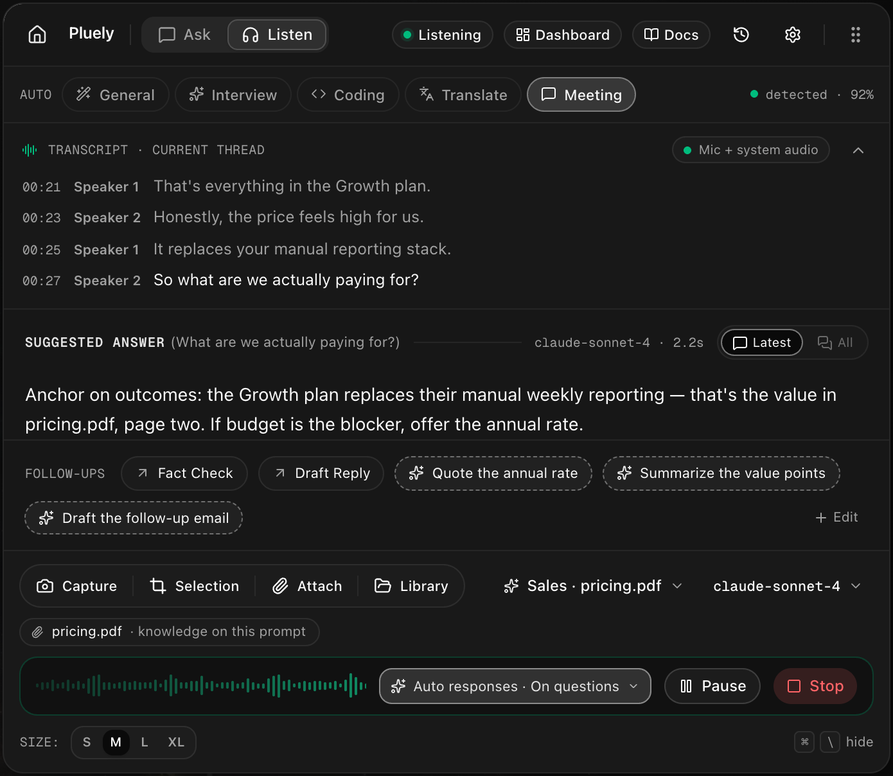
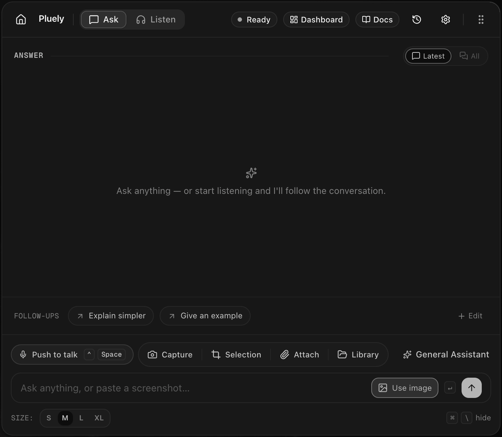
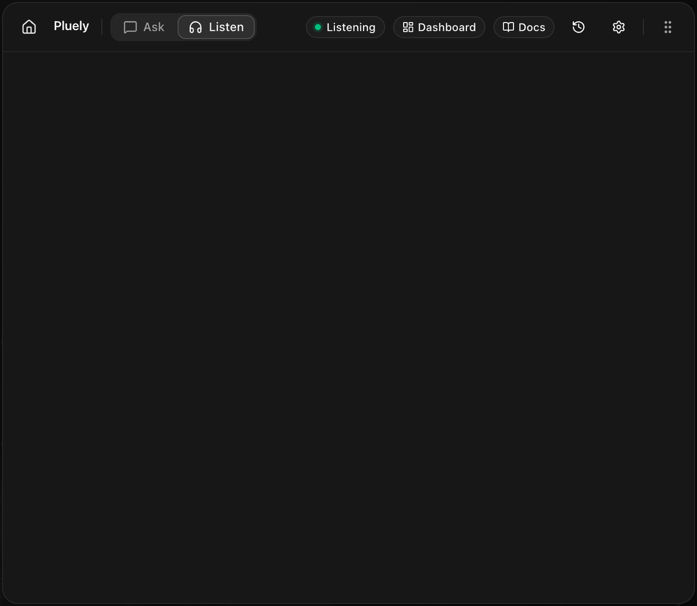

# Clocks v1 🚀

_One overlay, no tab, no trace._

<i>The actual overlay in Listen mode, floating over the desktop. Invisible on screen shares.</i>

---

[-lightgrey>)](#why-clocks-v1-is-closed-source)

### 💝 **Socials**

> **Your invisible AI, over everything you do.** Ask about anything on your screen. Listen to any conversation and have the right answer before you need it. One overlay, no tab, no trace. Invisible on screen shares, and no bot ever joins your calls.

📖 Every feature is documented at **[docs.clocks.com](https://docs.clocks.com)**, from the [5-minute quickstart](https://docs.clocks.com/docs/getting-started/quickstart) to [live transcription](https://docs.clocks.com/docs/features/listen-mode), [automatic responses](https://docs.clocks.com/docs/features/auto-responses), and [every keyboard shortcut](https://docs.clocks.com/docs/guides/overlay-shortcuts).

### 🔒 Why is Clocks closed source now?

Years of open Clocks code kept getting repackaged and sold as clones, and no license or complaint ever stopped it.
So v1 ships as signed binaries while the product itself stays free to use at its core.
The short story is [further down this page](#why-clocks-v1-is-closed-source), and everything else lives at [clocks.com](https://clocks.com).

---

## 📥 **Download Clocks**

### 🚀 **Get the Latest Release**

 &nbsp;  &nbsp; 

 &nbsp; 

**Available formats:** `.dmg` (macOS) • `.msi` / `.exe` (Windows) • `.deb` / `.rpm` / `.AppImage` (Linux)

**Free plan forever** · no account needed to start · updates ship automatically

---

## ✨ What is Clocks v1?

Clocks v1 is a ground-up rebuild: one translucent overlay with two modes, **Ask** and **Listen**, plus a full dashboard for your chats, meetings, files, prompts, and settings. It's built for the moments where switching to a browser tab would cost you the room: interviews, sales calls, standups, lectures, live debugging.

|         🪶 **Lightweight**          |             🕶️ **Invisible**             |                ⚡ **Instant**                |
| :---------------------------------: | :--------------------------------------: | :------------------------------------------: |
|      **9 to 16 MB** installer       | Hidden from screen shares and recordings |  Launches in under 100ms, answers in a tap   |
| A fraction of Electron alternatives | No meeting bot, no participant, no trace | Global hotkeys summon it from inside any app |
|   Minimal CPU and RAM, even live    |  Can hide from the Dock and taskbar too  |    Streaming answers, live transcription     |

## 💬 Ask mode

Type a question, dictate it with push-to-talk, or let Clocks see your screen: capture it, drag-select a region, attach files, or turn on **Use image** so every message carries a fresh screenshot. Documents go through built-in OCR and stay in context for follow-up questions. Answers stream in as Markdown, and everything is saved locally where you can search, export, or delete it.

## 🎧 Listen mode

Hit Start and Clocks transcribes your mic and system audio live, with speaker labels and language selection. Automatic responses fire when someone asks a question, after every pause, or only when you tap Suggest. Smart follow-up chips appear under each answer, generated from the actual conversation. Every session is saved as a meeting with its full transcript.

## 🧰 What else is in the box

- **200+ hosted models** on Pro plans: GPT, Gemini, Claude, Llama and more, searchable and switchable mid-conversation, no API keys to manage.
- **Free forever with your own keys**: connect any LLM or speech-to-text provider through a curl template, or plug in the AI CLIs you already have (Claude Code, Gemini CLI, Codex, Qwen Code, Ollama). No limits from us; it's your account.
- **Real stealth**: excluded from screen capture, absent from recordings and screenshots, never steals focus from the app you're in, and the [icon can disappear from the Dock or taskbar](https://docs.clocks.com/docs/settings/app-icon-stealth). Details in [Stealth & privacy](https://docs.clocks.com/docs/features/stealth-privacy).
- **Keyboard-first**: global hotkeys for summon, capture, and listening; single keys scroll the answer and transcript once the overlay has focus. Full reference: [Overlay shortcuts](https://docs.clocks.com/docs/guides/overlay-shortcuts).
- **Private by architecture**: chats, meetings, transcripts, and files live in a local SQLite database on your machine. Your own provider keys stay local. Your conversations never train anything.
- **Custom prompts with knowledge files**, a document library, plan and usage meters, and identical builds for macOS, Windows, and Linux.

The full tour with visuals is at **[clocks.com/features](https://clocks.com/features)**, and pricing is at **[clocks.com/pricing](https://clocks.com/pricing)**.

## 📚 Documentation

[docs.clocks.com](https://docs.clocks.com) covers every feature, setting, and edge case, with per-OS guides where platforms differ:

|                                       Start here                                        |                                  Features                                   |                                            Help                                             |
| :-------------------------------------------------------------------------------------: | :-------------------------------------------------------------------------: | :-----------------------------------------------------------------------------------------: |
|          [Quickstart](https://docs.clocks.com/docs/getting-started/quickstart)          |      [Listen mode](https://docs.clocks.com/docs/features/listen-mode)       |                   [FAQ](https://docs.clocks.com/docs/troubleshooting/faq)                   |
|   [macOS permissions](https://docs.clocks.com/docs/getting-started/permissions-macos)   |   [Auto responses](https://docs.clocks.com/docs/features/auto-responses)    | [Shortcuts not working](https://docs.clocks.com/docs/troubleshooting/shortcuts-not-working) |
| [Windows permissions](https://docs.clocks.com/docs/getting-started/permissions-windows) | [Stealth & privacy](https://docs.clocks.com/docs/features/stealth-privacy)  |            [Connect a CLI](https://docs.clocks.com/docs/settings/connect-a-cli)             |
|   [Linux permissions](https://docs.clocks.com/docs/getting-started/permissions-linux)   | [Keyboard shortcuts](https://docs.clocks.com/docs/guides/overlay-shortcuts) |                     [Supported models](https://docs.clocks.com/models)                      |

---

## Why Clocks v1 is closed source

Clocks started fully open, first under MIT and later under GPL-3. The code was lifted and sold as rebranded commercial products almost from day one, and moving to GPL-3 changed nothing: the clones ignored the license entirely. I filed complaints and takedown requests and nothing came down. Chasing license violators across countries costs more time and money than one developer has, and even code I shared privately in good faith ended up misused.

So from v1, a complete rewrite, Clocks ships as signed binaries only. The old GPL-3 code stays available under its license in this repo's history. Please don't ask for source access; the answer will be a polite no until I decide otherwise.

What doesn't change: the free plan stays free, releases ship right here, [issues](https://github.com/iamsrikanthnani/clocks/issues) stay open for bug reports, and your data stays on your device.

---

## 📋 Prerequisites

Clocks installs like any normal desktop app. On Linux you need the WebKitGTK runtime that Tauri apps use, see [Tauri's prerequisites page](https://v2.tauri.app/start/prerequisites/) for your distro. macOS and Windows need nothing extra: grant the [screen and microphone permissions](https://docs.clocks.com/docs/getting-started/permissions-macos) on first run and you're set.

---

## 🐛 Feedback & bug reports

Found a bug or have an idea? Open a [GitHub issue](https://github.com/iamsrikanthnani/clocks/issues) or use [clocks.com/feedback](https://clocks.com/feedback). Real reports get fixed fast. For account or license help: [support@clocks.com](mailto:support@clocks.com).

> 💡 **Like this project?** Consider [buying me a coffee ☕](https://www.buymeacoffee.com/srikanthnani)

---

## 📄 License

Clocks v1 and later are proprietary, closed-source software distributed as binaries. See [Why Clocks v1 is closed source](#why-clocks-v1-is-closed-source). Versions that were published under the GPL-3 remain available under that license in this repository's history.

---

## 🙏 Acknowledgments

- **[Tauri](https://tauri.app/)** - Amazing desktop framework
- **[tauri-nspanel](https://github.com/ahkohd/tauri-nspanel)** - macOS native panel integration for Tauri
- **[shadcn/ui](https://ui.shadcn.com/)** - Beautiful UI components

---

## 🔗 Links

- **Website**: [clocks.com](https://clocks.com/)
- **Documentation**: [docs.clocks.com](https://docs.clocks.com)
- **Models**: [clocks.com/models](https://clocks.com/models)
- **Pricing**: [clocks.com/pricing](https://clocks.com/pricing)
- **Releases**: [clocks.com/releases](https://clocks.com/releases)
- **Issues**: [GitHub Issues](https://github.com/iamsrikanthnani/clocks/issues)
- **Discussions**: [GitHub Discussions](https://github.com/iamsrikanthnani/clocks/discussions)

---

### 🌐 **Let's Connect**

&nbsp;
&nbsp;

&nbsp;

---

**Made with ❤️ by [Srikanth Nani](https://www.srikanthnani.com/)**
